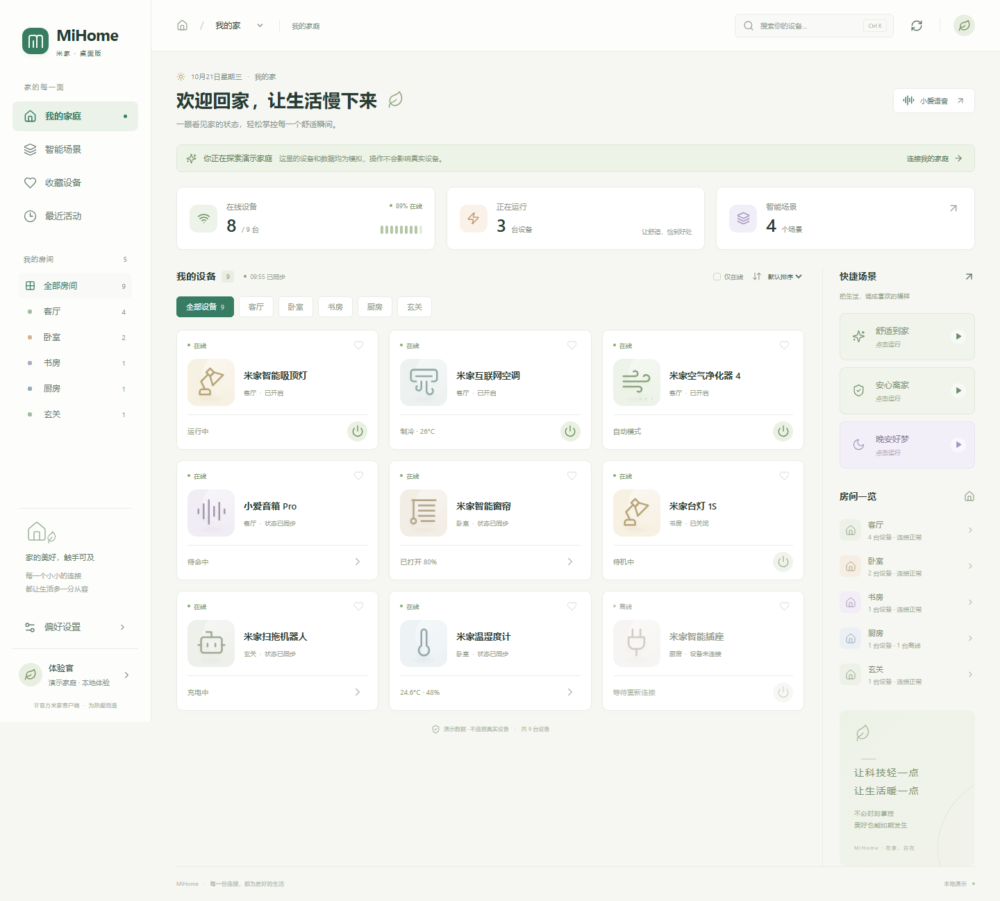

# MiHome Desktop · 米家桌面

使用 **Rust + Tauri 2 + React / TypeScript** 重写的非官方米家 Windows 客户端。参考 [huanyuejue/MiHome-Windows](https://github.com/huanyuejue/MiHome-Windows)，米家协议参考 [Do1e/mijia-api](https://github.com/Do1e/mijia-api)。不启动 Python、不依赖 PySide，不是网页外壳套原程序。

> **当前为 0.1.0 重写版，不宣称已经完整替代上游。** 云端协议为非官方接口，可能随小米更新而失效。自动化测试与演示操作不能代替真实账号、真实设备验收。仅支持 Windows 凭据存储，默认使用中国大陆服务器。



> **本机验证状态：** 前端检查已通过，MSVC Debug 桌面程序已编译并显示 MiHome 主窗口；真实账号、设备、托盘与安装行为本轮未实测。此前标准 Release 构建曾被本机资源链接问题阻断，本轮未复验 Release 或安装包。Rust 测试和真实二维码生成/取消的此前结果见 [验证记录](docs/VERIFICATION.md)。

## 快速开始

前置条件：Node.js 22.12+ 或 24 LTS、pnpm 10.32.1、Rust stable 1.90+（MSVC 工具链）、Visual Studio 2022 Build Tools「使用 C++ 的桌面开发」、Windows 10/11 的 Microsoft Edge WebView2 Runtime。

项目统一使用 pnpm，版本由 `packageManager` 固定，提交 `pnpm-lock.yaml`。首次安装 pnpm 可执行 `npm install --global pnpm@10.32.1`；已有 pnpm 时直接运行下面的命令。CI 和 Windows 启动脚本使用 `--frozen-lockfile`，确保依赖与锁文件一致。

```powershell
pnpm install --frozen-lockfile
pnpm run desktop:dev
```

启动脚本支持识别被 git 忽略的 `.tools/cargo` 本地 Rust 工具链，也支持正常的系统 Rust 安装，无需这一目录。Windows 请使用 MSVC 工具链；本机默认工具链若为 GNU，可先在当前 PowerShell 设置 `$env:RUSTUP_TOOLCHAIN = 'stable-x86_64-pc-windows-msvc'` 再启动。

### 仅体验界面

```powershell
pnpm run dev
```

打开 `http://127.0.0.1:1420`。浏览器仅使用明确标识的演示数据，**不能登录或控制真实设备**。演示模式的开关、属性、场景、音箱指令均不会向云端发送请求。桌面版首次启动不加载演示家庭，必须扫码或主动点击「体验演示」。

### 构建 Windows 程序

```powershell
pnpm run desktop:build
# 仅生成 exe，不生成安装包
pnpm run desktop:build --no-bundle
```

输出位于 `src-tauri/target/release/`；安装包位于其 `bundle/` 子目录。未配置代码签名，Windows SmartScreen 提示并不意味着获得了官方安全认证；请审查源码和构建来源。

## 功能

- 中文家庭面板，家庭/房间筛选、搜索、在线筛选、设备收藏。
- 小米账号二维码登录；Rust 实现登录长轮询、Cookie、令牌刷新、RC4-drop1024 请求加解密和签名。登录可取消，二维码有有效期。
- 自有与共享设备列表，家庭设备完整分页，在线状态、缓存标识及非致命同步告警。独立共享设备端点若提示额外分页，当前显示首批并明确告警，不宣称已经加载全量。
- 读取官方 MIoT spec，按规格生成布尔开关、范围/步长滑块、枚举选择与只读值。无法读取的属性显示错误，不猜测真实状态。
- 写入前校验可写性、类型、范围、步长、枚举选项；离线设备不可操作。
- 设备动作输入与二次确认，家庭手动场景确认执行，小爱音箱文字指令。
- 系统/浅色/深色主题，界面缩放、刷新间隔、隐藏无规格设备、默认音箱等本地设置。
- 系统托盘显示/隐藏/退出，关闭到托盘；Windows 开机自启动。
- 最近活动为**当前界面会话**内的操作记录，不伪装成米家历史日志。

### 与上游的差异 / 后续工作

| 上游能力                              | 本次重写                                                               |
| ------------------------------------- | ---------------------------------------------------------------------- |
| 扫码、设备列表、家庭/房间、属性与动作 | 已实现原生 Rust 链路，尚需用户真实设备验收                             |
| 手动场景、小爱文字指令                | 已实现；并非麦克风录音/语音识别                                        |
| 主题、缩放、缓存、自启动、托盘        | 已实现基础版本                                                         |
| 托盘专属快捷面板、设备/场景混排排序   | 暂未迁移；当前托盘用于显示主界面与退出                                 |
| 可自定义拖拽工作台                    | 暂未迁移；采用自动生成的规格详情面板                                   |
| 自动检查 GitHub Releases / 自动升级   | 暂未实现；本重写版没有配置其自身发布源，不使用上游版本号冒充本应用更新 |
| 共享上游明文 auth.json 凭据           | 有意不沿用；本应用单独扫码并使用 Windows DPAPI 保存                    |
| 地区切换、局域网直连、米家自动化编辑  | 当前界面不提供；不是全量米家 App 替代品                                |

蓝牙专用设备、无公开规格设备以及需要私有协议的型号不保证可控。MIoT 属性名可能使用官方英文描述，没有适配的字段不会被虚构成功能。不要用本程序控制涉及人身/财产安全的关键设备。

## 数据与安全

- 所有真实米家请求由 Rust 发出。WebView 不保存密码、`ssecurity`、`passToken` 或 `serviceToken`。
- 凭据使用 Windows **当前用户** DPAPI 加密后写入应用数据目录中的 `credentials.dpapi`。换用户或换机器无法直接复用该文件。
- 设置及设备快照为 JSON 文件；这些文件仍包含家庭、房间和设备名称等隐私信息，请勿公开上传。具体路径可在「设置 → 关于」查看。
- 演示设置使用独立的 `mihome.demo.settings.v1` 浏览器存储键，与真实桌面设置分离。
- 退出登录会清除本应用保存的凭据和设备快照；它不等于在小米服务端撤销账号授权。请在小米账号安全页面管理服务端会话。
- 本程序不自动读取其他客户端的认证文件、不接收小米密码。请仅扫描自己启动的客户端显示的二维码。

## 验证命令

```powershell
pnpm test                                      # TypeScript 纯逻辑与桥接隔离测试
pnpm run build                                 # TypeScript 检查 + Vite 生产构建
pnpm exec playwright install chromium
pnpm run test:e2e                              # 开发模式浏览器回归
pnpm run test:e2e:production                   # 实际生产产物回归，先停止占用 1420 的服务
node scripts/rust.mjs test --lib --locked     # Rust 加密、模型、存储等测试（不链接桌面 bin）
node scripts/rust.mjs test --locked           # 完整目标测试，需要本机资源链接环境正常
node scripts/rust.mjs fmt --all -- --check
node scripts/rust.mjs clippy --all-targets --locked -- -D warnings
```

GitHub Actions 已提供 Windows 验证配置。详细验证记录见 [验证说明](docs/VERIFICATION.md)。

### 真实设备验收建议

1. 运行桌面版，打开扫码登录，使用米家 App 扫码并确认；关闭再启动，验证会话恢复。
2. 核对家庭、房间、共享设备与手动场景，与手机 App 对照。
3. 选择非关键设备，读取属性后试一次开关或亮度写入，再用手机核实实际变化。
4. 验证离线设备不会显示写入成功；断网时应显示错误并保留带缓存标识的列表。
5. 分别验证场景和小爱文字指令，确认参数、目标家庭和音箱没有混淆。
6. 退出登录，确认重启后不会显示原账号设备。

## 项目结构

```text
src/
  app/                  应用入口、Context 与全局弹层
  pages/                家庭、场景、收藏与会话活动视图
  components/           layout、devices、scenes、dialogs、ui
  hooks/                初始化、刷新、设置与设备操作编排
  api/                  Tauri 命令接口与独立演示 adapter
  mocks/                明确标识的虚构设备数据
  utils/                属性校验、筛选、设备分类与展示函数
  types/                前后端共享 JSON 契约
  styles/               主题、布局、组件与响应式样式
src-tauri/
  src/                  Rust 认证、米家云端、规格、存储与 Tauri 命令
  capabilities/         本地窗口权限
scripts/                Tauri / Cargo 启动辅助脚本
tests/e2e/              浏览器端集成测试
```

协议变化集中在 Rust 云端模块，界面通过 `src/api/mihome.ts` 调用；演示 adapter 和真实 adapter 使用同一套类型，但不共享凭据或写请求。

前端目录、状态、API、依赖和验证约定见 [前端开发规范](docs/FRONTEND.md)。视觉以用户提供的 [桌面 UI 设计规范](docs/米家桌面端_UI设计规范.md) 和 [系统展示板](docs/米家全屋智能设计系统展示板.png) 为准；适配细节见 [实施规范](docs/UI_DESIGN.md)，20 个页面的路由、交互及服务边界见 [页面覆盖清单](docs/PAGE_COVERAGE.md)。AI 修改项目从 [AGENTS.md](AGENTS.md) 开始。

## 许可

[GPL-3.0-or-later](LICENSE)。来源与第三方声明见 [THIRD_PARTY_NOTICES.md](THIRD_PARTY_NOTICES.md)。小米/米家/小爱商标属于各自权利人。本程序不是小米官方产品，不含任何担保，使用前请遵守相关服务条款。
